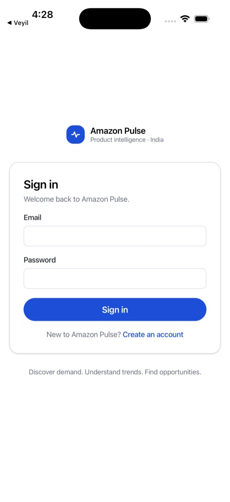
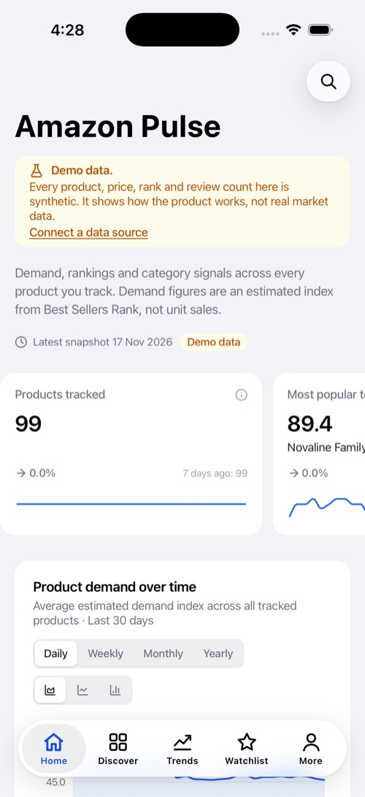
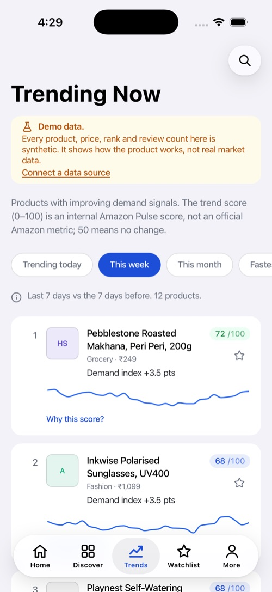
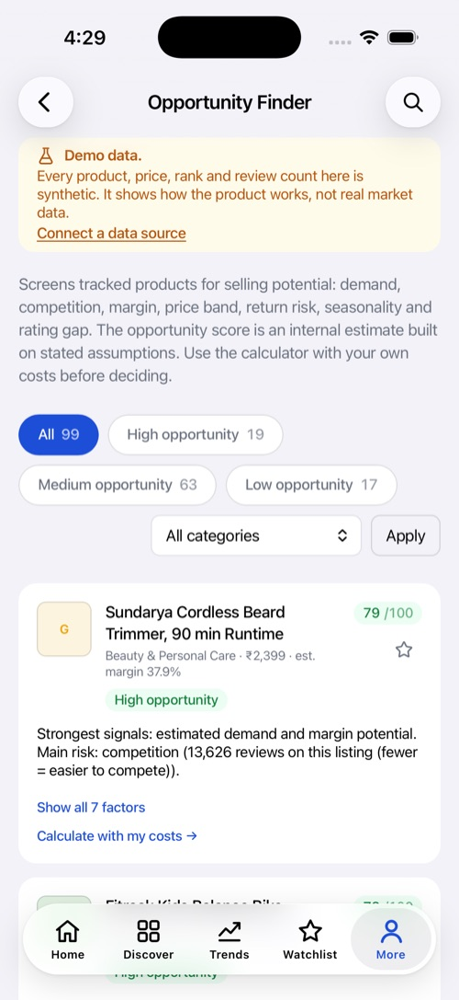

# Amazon Pulse for iPhone

A native SwiftUI shell (WKWebView, iOS 17+) around the live Amazon Pulse dashboard at https://thedal-pulse.vercel.app,
generated from the Kolam iOS shell template (kolam-design-system/ios/shell-template).
Inside this app the dashboard switches to Apple's Human Interface Guidelines look (Kolam iOS kit: large titles,
Liquid Glass tab bar, back + centred title, haptics); in Safari or any other browser it keeps its own look.
Sign-in is email and password with a first-party session cookie, so it works inside the app's web view.
Web app source: https://github.com/tgopinath/Paadal/tree/feature/amazon-pulse-phase1/amazon-pulse

   

The dashboard screenshots show the app's demo-data mode (a local build), since the live site needs an account.

## Run it

```sh
xcodebuild -project AmazonPulse.xcodeproj -scheme AmazonPulse \
  -destination 'platform=iOS Simulator,name=iPhone 17 Pro' -derivedDataPath build CODE_SIGNING_ALLOWED=NO build
```

Then install `build/Build/Products/Debug-iphonesimulator/AmazonPulse.app` with `xcrun simctl install booted …`.
Debug builds accept `-KolamStartURL "<url>"` on `simctl launch` to open another route.
Installing on other people's iPhones needs TestFlight or the App Store (Apple Developer Program).
